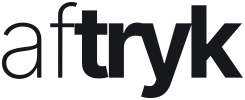

# Aftryk – brand

**Aftryk** is the creative studio workspace: projects, clients, brand hubs and the apps that make
things on a client's brand.

*Aftryk* is Danish for an imprint – the mark something leaves behind. *At sætte sit aftryk* is to
leave your mark on something, which is what a studio is hired to do, and what it hands the client at
the end. The word is also a printing word, which suits a tool that ends in print-ready PDFs.

Domains: **aftryk.app** (main, to register). aftryk.dk and aftryk.studio are free too. aftryk.com is
taken by someone else, so .app is the home.

## The logo

One word in two weights: **af** a hairline, **tryk** bold. The light half comes first, so the word
presses down as it is read, and the weight lands on the half that carries the meaning – *tryk*: the
press, the print, the pressure. The letters are Inter Tight (ExtraLight and Bold), tightly spaced and
outlined – so the logo never depends on a font being installed.

| File | Use |
| --- | --- |
| `public/brand/aftryk-wordmark.svg` | Blæk on light backgrounds – the default |
| `public/brand/aftryk-wordmark-paper.svg` | Papir on Blæk, Kobolt or photos |
| `public/brand/aftryk-wordmark-cobalt.svg` | Kobolt on Papir, for a bit of colour |
| `public/brand/aftryk-icon.svg` | The app icon: the mark on a Blæk tile |
| `public/brand/aftryk-mark.svg` | The mark alone, no tile |
| `public/favicon.svg` | The browser tab |

In code: `<Wordmark />` and `<Mark />` from `src/components/brand.tsx` (`<Logo />` in
`components/ui.tsx` wraps the wordmark for the app).

**The mark** is the same idea in two letters – a hairline **a**, a bold **t**. They read *at*: Danish for 'to', as in *at trykke*, to press. It's for places
too small for the word: the app icon, the favicon, social avatars. (Not a lone f on a blue square:
that's someone else's.)

**Rules**

- Keep clear space of at least the height of the "o" all round.
- Smallest size: 14 px tall on screen, 4 mm in print. Below that, use the mark.
- One colour at a time – Blæk, Papir or Kobolt. No gradients, outlines, shadows or other colours.
- Don't stretch it, re-space it, set it in another font or change the weights.
- Always lowercase, always one word. In running text it's *Aftryk*.
- Don't add ® until the name is registered – in Denmark (and most places) the ® may only be used
  for a registered mark.

**Changing it**: `npx tsx scripts/wordmark.mts` re-outlines the letters (weights and spacing are at
the top), then `npx tsx scripts/brand-files.mts` writes the SVG files, the favicon and the logo on
the loading screen.

## Colours

Nordic and calm: ink on paper, with the blue of Danish porcelain.

| Name | Hex | Use |
| --- | --- | --- |
| **Blæk** (ink) | `#16181B` | Text, the logo, dark surfaces |
| **Papir** (paper) | `#F4F1EA` | Backgrounds, the logo on dark |
| **Kobolt** (cobalt) | `#2340D1` | Actions, links, the one thing to press |
| Kobolt lys | `#E6EAFB` | Selected rows, soft highlights |
| **Hyben** (rosehip) | `#E0623C` | Sparingly: a highlight, an illustration |
| **Sten** (stone) | `#8A8880` | Secondary text, lines |

In the app they're the tokens in `src/styles.css` (`--blue` is Kobolt; in dark mode it's lighter,
`#6C83F5`, to read on dark). White text on Kobolt passes WCAG AA for all sizes.

## Type

- **Inter Tight** – everything: interface, headings, the logo. By Rasmus Andersson (Sweden).
- **Instrument Serif** – the occasional accent word in a headline (*In great form.*), never for
  long text.
- **JetBrains Mono** – small labels and eyebrows, uppercase and spaced.

## Voice

Short, warm and direct – the way a good Danish studio talks to its clients. Plain words over
jargon ("Put online", not "Publish deployment"). Say what happens, then stop. English and Danish
are equals: every text is written for both.

- Tagline: **Good work. In great form.**
- One line: *One space for your studio – from first idea to final file.*
